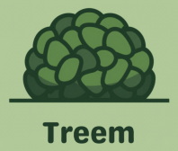

A small declarative state management library. You describe your app as a plain object tree — state, derived values, and actions — then call `run()` to get a live, callable interface.

## Examples

Live demos hosted on GitHub Pages:

| Example | Tags | Description |
|---|---|---|
| [Counter](https://santistebanc.github.io/treem/counter/) | vanilla | Basic `ref`, `calc`, `update`, step control |
| [Traffic Light](https://santistebanc.github.io/treem/traffic-light/) | vanilla | Timed state machine with `iff` and reactive transitions |
| [Pricing](https://santistebanc.github.io/treem/pricing/) | vanilla | Reactive plan selector with distributed `iff` |
| [Wizard](https://santistebanc.github.io/treem/wizard/) | vanilla | Multi-step form with validation, arrays, and nested scopes |
| [Brew Shop](https://santistebanc.github.io/treem/shop/) | vanilla | Cart with coupons, theming, and `event` for toast feedback |
| [User Search](https://santistebanc.github.io/treem/search/) | vanilla | Async fetch with debounce, abort, and `event` for analytics |
| [Todo](https://santistebanc.github.io/treem/react-todo/) | React | TodoMVC-style app using treem as the store |
| [Devtool](https://santistebanc.github.io/treem/devtool/) | devtools | Interactive tree inspector for treem program state |

---

## Quick look

```ts
import { ref, calc, iff, update, arg, run, watch } from 'treem'

const theme = ref<'light' | 'dark'>('theme')
const lang  = ref<'en' | 'es'>('lang')

// extract conditions into named expressions — keeps the tree readable
const isDark  = calc(t => t === 'dark',  [theme])
const isLight = calc(t => t === 'light', [theme])
const isEn    = calc(l => l === 'en',    [lang])

const app = run({
  [theme]: 'light',
  [lang]:  'en',

  toggleTheme: update({ [theme]: iff(isLight, 'dark', 'light') }),
  updateLang:     update<['en' | 'es']>({ [lang]: arg<'en' | 'es'>(0) }),

  // iff over objects distributes key-by-key — each key is its own reactive node
  ui: iff(isDark, {
    background: '#111',
    foreground: '#eee',
    welcome:    iff(isEn, 'Good night',   'Buenas noches'),
  }, {
    background: '#fff',
    foreground: '#111',
    welcome:    iff(isEn, 'Good morning', 'Buenos días'),
  }),
})

app.ui.background()  // '#fff'
app.ui.welcome()     // 'Good morning'

app.updateLang('es')
app.ui.welcome()     // 'Buenos días'

app.toggleTheme()
app.ui.background()  // '#111'
app.ui.welcome()     // 'Buenas noches'

watch(app.ui, ui => console.log(ui))
app.toggleTheme()    // → { background: '#fff', foreground: '#111', welcome: 'Buenos días' }
```

---

## Primitives

### `ref` — state slot

A named piece of state. Use it as an object key to define it, and pass it as an argument to read from it. Provide a type parameter for downstream inference.

```ts
const count  = ref<number>('count')
const isDark = ref<boolean>('isDark')
const user   = ref<string>('user')
```

A ref is itself an expression — it can appear anywhere a value is expected in the tree, not just as a key or calc argument. No wrapper needed:

```ts
const x = ref<number>('x')

{
  val:     x,                          // read x directly — no calc wrapper needed
  doubled: calc(n => n * 2, [x]),     // pass x to a calc
  label:   iff(x, 'non-zero', 'zero'), // use x as an iff condition
  copy:    update({ [x]: x }),              // read x inside a update assignment
}
```

### `calc` — derived value

A computed value that reads from one or more expressions. Argument types are inferred from the type parameters of any `ref` or `calc` nodes passed in.

```ts
const count = ref<number>('count')

// reads from a ref
const doubled = calc(n => n * 2, [count])

// reads from a literal and a ref
const total = calc((price, qty) => price * qty, [9.99, count])

// calcs can be nested freely
const display = calc(t => `Total: $${t.toFixed(2)}`, [total])
```

Defining calcs outside the tree keeps the tree readable and makes expressions reusable across multiple nodes:

```ts
const isPro     = calc(p => p === 'pro', [plan])
const fullName  = calc((f, l) => `${f} ${l}`, [firstName, lastName])

const app = run({
  // ...
  badge:    iff(isPro, 'Pro', 'Free'),     // reuse isPro in iff
  greeting: calc(n => `Hi, ${n}`, [fullName]), // reuse fullName in another calc
})
```

Use `Expr<T>` in helper signatures to accept both plain values and reactive refs:

```ts
import { Expr } from 'treem'

const multiply = (a: Expr<number>, b: Expr<number>) =>
  calc((x, y) => x * y, [a, b])

multiply(count, 3)        // ref × literal
multiply(doubled, count)  // calc × ref
```

### `iff` — conditional

Picks between two values based on a condition.

```ts
// scalar branches — picks one
iff(isDark, '#1a1a1a', '#ffffff')
iff(isLoggedIn, userPanel, loginForm)

// branches can be any expression
const x = ref<number>('x')
iff(calc(n => n > 0, [x]), 'positive', 'non-positive')
```

When **both** branches are plain objects, `iff` distributes key-by-key. Each key becomes its own independent conditional rather than switching the whole object:

```ts
iff(isLoggedIn,
  { label: 'Log out', icon: 'door-open'  },
  { label: 'Log in',  icon: 'door-closed' }
)
// equivalent to:
// {
//   label: iff(isLoggedIn, 'Log out', 'Log in'),
//   icon:  iff(isLoggedIn, 'door-open', 'door-closed'),
// }
```

When **one** branch is a plain object and the other is a scalar, the scalar is the resolved value of the whole scope when its branch is active, while the object keys are still accessible individually:

```ts
// when flag is false → p.s() === 'fallback'
// when flag is true  → p.s() returns { val: 1 }
iff(flag, { val: 1 }, 'fallback')
```

`onFalse` is optional — omitting it means the value is `undefined` when the condition is false. Useful for optional UI elements or error messages that only exist in one state:

```ts
const hasError = ref<boolean>('hasError')

iff(hasError, 'Something went wrong')
// true  → 'Something went wrong'
// false → undefined

// works with object branches too
iff(hasError, { message: 'Something went wrong', code: 500 })
// true  → each key resolves normally
// false → each key resolves to undefined
```

### `update` — action

Declares a state mutation. All assignments are evaluated from the current state before any are applied, making swaps safe:

```ts
const a = ref<number>('a')
const b = ref<number>('b')

// increments count
const increment = update({ [count]: calc(n => n + 1, [count]) })

// reupdates to a literal
const reupdate = update({ [count]: 0 })

// atomically swaps a and b
const swap = update({ [a]: b, [b]: a })
```

### `arg` — action argument

Reads a runtime argument passed when an action is called. Combine with `update` to make parameterized actions. The type parameter on `update<Args>` declares the full argument tuple:

```ts
const price = ref<number>('price')

const app = {
  [price]: 10,
  updatePrice:   update<[number]>({ [price]: arg<number>(0) }),
  addToPrice: update<[number]>({ [price]: calc((p, n) => p + n, [price, arg<number>(0)]) }),
  updateRange:   update<[number, number]>({ [min]: arg<number>(0), [max]: arg<number>(1) }),
}

const store = run(app)
store.updatePrice(42)        // price → 42
store.addToPrice(8)       // price → 50
store.updateRange(0, 100)
```

### `event` — event channel

Declares a typed event channel. Use it as a key in an `update` assignments object to emit, and pass it directly to `watch` to subscribe. Unlike state refs, events carry no persistent value — they fire and are gone.

Use events to decouple one-time side effects (toasts, analytics, navigation) from persistent state. A `watch` on state fires once immediately and whenever the value changes; a `watch` on an event fires only when the event is explicitly emitted.

```ts
import { ref, calc, event, update, arg, run, watch } from 'treem'

const itemCount   = ref<number>('itemCount')
const itemAdded   = event<[name: string, qty: number]>('itemAdded')
const cartCleared = event<[]>('cartCleared')

const store = run({
  [itemCount]: 0,

  // State mutation and event emission happen in the same update call.
  // All state updates apply first, then events fire.
  add: update<[string, number]>({
    [itemCount]: calc((n, qty) => n + qty, [itemCount, arg<number>(1)]),
    [itemAdded]: [arg<string>(0), arg<number>(1)],
  }),

  clear: update({
    [itemCount]: 0,
    [cartCleared]: [],
  }),
})

// Side effects subscribe to events, not state — they only run when something happens.
watch(itemAdded,   (name, qty) => console.log(`Added ${qty}× ${name}`))
watch(cartCleared, ()          => console.log('Cart cleared'))

store.add('coffee', 2)   // → "Added 2× coffee"
store.add('espresso', 1) // → "Added 1× espresso"
store.clear()            // → "Cart cleared"

store.itemCount()        // 0  — state is still queryable normally
```

Event emission values can be any expressions — `arg`, `calc`, `iff` — evaluated at call time from the current state and arguments:

```ts
const checkout = event<[{ total: number; itemCount: number }]>('checkout')

update({
  [checkout]: [calc((total, n) => ({ total, itemCount: n }), [cartTotal, itemCount])],
})
```

Events emit **after** all state updates in the same `update` call have been applied and propagated.

### `run` — instantiate

Takes the app tree and returns a callable interface. Calling any node resolves its current value. The return type mirrors the shape of the app tree.

```ts
const store = run(app)

store()              // resolve the whole root as a plain object
store.cart()         // resolve the 'cart' subtree
store.cart.total()   // read a single value
store.cart.add()     // call an action
```

Resolved objects contain only string-keyed children — ref definitions (`[ref]: value`) are state slots, not output keys.

Each call to `run()` creates a fully independent instance with its own state:

```ts
const p1 = run({ [count]: 0, ... })
const p2 = run({ [count]: 0, ... })

p1.increment()
p1.val()  // 1
p2.val()  // 0  — unaffected
```

Call `dispose()` to tear down the program. All active watchers stop firing and their cleanup functions run:

```ts
const store = run({ ... })

watch(store.total, total => {
  const el = document.getElementById('total')!
  el.textContent = String(total)
  return () => el.textContent = ''   // cleanup runs on dispose
})

store.dispose()   // all watchers stopped, cleanups called
```

### `watch` — reactive subscription

Subscribes to any node in the program. The callback fires immediately with the current value, then again whenever any dependency changes. Returns an unsubscribe function.

```ts
import { watch } from 'treem'

const unwatch = watch(store.cart, cart => {
  console.log('cart changed:', cart)
})

store.cart.add()   // → callback fires with new cart value
store.cart.add()   // → fires again
unwatch()          // stop watching
store.cart.add()   // → silence
```

The callback only fires when the resolved value actually changes. If a dependency updates but the output remains the same, the callback is skipped.

The callback can optionally return a cleanup function. It runs before the next callback invocation and when unsubscribing — useful for clearing timers, removing event listeners, or any other side effect teardown:

```ts
watch(store.route, route => {
  const controller = new AbortController()
  fetchData(route, { signal: controller.signal })
  return () => controller.abort()
})
```

Any node is watchable — subtrees, individual values, and arrays:

```ts
watch(store.total,   v => console.log('total:', v))
watch(store.sidebar, v => console.log('sidebar:', v))
watch(store.items,   v => console.log('items:', v))
```

---

## App tree structure

The app is a plain object where:

- **`[ref]: value`** — defines a ref at this scope with an initial value (can be a formula)
- **`key: value`** — a derived value or nested scope
- **`key: update({...})`** — an action
- **`key: [...]`** — an array of values or nested scopes

```ts
const qty  = ref<number>('qty')
const name = ref<string>('name')

const app = {
  [name]: 'Guest',                            // mutable state

  greeting: calc(n => `Hello, ${n}!`, [name]),   // derived value
  rename: update<[string]>({ [name]: arg<string>(0) }), // parameterized action

  cart: {                                        // nested scope
    [qty]: 0,
    total: calc(q => q * 9.99, [qty]),
inc:   update({ [qty]: calc(q => q + 1, [qty]) }),
clear: update({ [qty]: 0 }),
  },
}
```

---

## Arrays

Arrays work naturally in the tree. Object elements become nested scopes; node elements (calc, iff, refs) are reactive:

```ts
const active = ref<boolean>('active')

const app = {
  [active]: false,
  toggle: update({ [active]: calc(b => !b, [active]) }),

  tabs: [
    { label: 'Home',     disabled: false },
    { label: 'Settings', disabled: iff(active, false, true) },
    { label: 'Profile',  disabled: false },
  ],
}

const store = run(app)
store.tabs[1].disabled()   // true
store.toggle()
store.tabs[1].disabled()   // false

watch(store.tabs, tabs => console.log('tabs:', tabs))
```

---

## Scoping rules

Each nested object is a scope. A ref defined with `[ref]: value` is local to that scope and its descendants.

**A ref formula may only read from refs defined in ancestor scopes — not siblings.** This keeps the dependency graph acyclic and ensures correct update ordering.

```ts
const price = ref<number>('price')
const qty   = ref<number>('qty')

const app = {
  [price]: 9.99,           // root price

  regular: {
    [qty]: 0,
    total: calc((p, q) => p * q, [price, qty]),  // reads ancestor price ✓
    add:   update(() => ({ [qty]: calc(q => q + 1, [qty]) })),
  },

  sale: {
    [price]: 4.99,         // overrides price for this scope only
    [qty]: 0,
    total: calc((p, q) => p * q, [price, qty]),  // uses the overridden price ✓
    add:   update(() => ({ [qty]: calc(q => q + 1, [qty]) })),
  },
}
```

When `update` targets a ref, it resolves to the nearest ancestor definition visible from the action's location — the same rule that reads use.

---

## Reactivity

- **Mutable state** — `[qty]: 0` defines a ref that can be freely updated with `update`.
- **Reactive formula** — `[qty]: calc(...)` defines a ref whose value is driven by a formula. Whenever the formula's dependencies change, the ref reupdates to the formula result. Any manual `update` is overwritten on the next dependency change.

```ts
const isPro = ref<boolean>('isPro')
const qty   = ref<number>('qty')

const app = {
  [isPro]: false,
  togglePro: update({ [isPro]: calc(b => !b, [isPro]) }),

  cart: {
    [qty]: iff(isPro, 0, 0),  // reactive: reupdates to 0 whenever isPro changes
    add:   update(() => ({ [qty]: calc(q => q + 1, [qty]) })),
  },
}

const store = run(app)
store.cart.add()      // qty → 1
store.cart.add()      // qty → 2
store.togglePro()     // isPro flips → qty formula reruns → qty reupdates to 0
```

Propagation is efficient: if a dep changes but the computed output stays the same, dependents are not re-evaluated and watchers are not notified.

---

## Advanced

### `VALUE` — whole-scope value

When `iff` distributes over objects, it creates a scope where each key is an independent reactive node. In the mixed case — one branch is an object, the other is a scalar — the scalar is stored on the scope under the `VALUE` symbol. Reading the scope as a whole (calling it as a function) returns `VALUE` when its branch is active, otherwise resolves the object keys as usual.

You can import `VALUE` to read this directly when you need it:

```ts
import { ref, iff, update, run, VALUE } from 'treem'

const flag = ref<boolean>('flag')

const store = run({
  [flag]: false,
  s: iff(flag, { x: 1, y: 2 }, 'fallback'),
})

store.s()           // 'fallback'  — scalar branch active, returns VALUE
store.s.x()         // undefined   — x is undefined when scalar branch is active

// flag → true
store.s()           // { x: 1, y: 2 }
store.s.x()         // 1
```

This is mostly an implementation detail you won't need to reach for — calling the scope as a function handles it automatically. It becomes useful when building abstractions over `iff` results that need to distinguish between the scalar and object branches.

---

## Comprehensive example

A multi-step signup wizard that puts every feature to work: nested scopes, reactive formulas, distributed conditionals, parameterized actions, arrays, watchers, and events.

```ts
import { ref, calc, iff, event, update, arg, run, watch, type Expr } from 'treem'

// ─── State ────────────────────────────────────────────────────────────────────

const step   = ref<number>('step')    // 1 | 2 | 3
const name   = ref<string>('name')
const email  = ref<string>('email')
const plan   = ref<'free' | 'pro'>('plan')
const agreed = ref<boolean>('agreed')

// ─── Events ───────────────────────────────────────────────────────────────────

type SignupPayload = { name: string; email: string; plan: 'free' | 'pro' }
const submitted = event<[SignupPayload]>('submitted')

// ─── Helpers ─────────────────────────────────────────────────────────────────

const isStep = (n: number) => calc(s => s === n, [step])
const clamp  = (lo: number, hi: number, x: Expr<number>) =>
  calc(v => Math.min(Math.max(v, lo), hi), [x])

// named expressions — reused in multiple places, keep the tree clean
const isPro   = calc(p => p === 'pro', [plan])
const nameOk  = calc(n => n.trim().length > 0, [name])
const emailOk = calc(e => /^[^@]+@[^@]+$/.test(e), [email])

// ─── App ─────────────────────────────────────────────────────────────────────

const wizard = run({
  [step]:   1,
  [name]:   '',
  [email]:  '',
  [plan]:   'free',
  [agreed]: false,

  // ── Navigation ──────────────────────────────────────────────────────────────
  next: update({ [step]: clamp(1, 3, calc(s => s + 1, [step])) }), // clamp keeps step in [1,3]
  back: update({ [step]: clamp(1, 3, calc(s => s - 1, [step])) }),

  // ── Step 1: personal details ─────────────────────────────────────────────────
  details: {
    updateName:  update<[string]>({ [name]:  arg<string>(0) }),
    updateEmail: update<[string]>({ [email]: arg<string>(0) }),

    errors: {
      name:  iff(nameOk,  '',          'Name is required'),
      email: iff(emailOk, '',          'Invalid email'),
    },
  },

  // ── Step 2: plan selection ───────────────────────────────────────────────────
  //    iff over objects → each key is an independent reactive node
  planInfo: iff(isPro, {
    label:     'Pro',
    price:     '$12 / month',
    seats:     'Up to 10',
    apiAccess: true,
    cta:       calc(n => `Upgrade, ${n}!`, [name]),
  }, {
    label:     'Free',
    price:     'Free forever',
    seats:     '1 seat',
    apiAccess: false,
    cta:       'Get started',
  }),

  updatePlan: update<['free' | 'pro']>({ [plan]:   arg<'free' | 'pro'>(0) }),
  agree:   update({ [agreed]: true }),
  // submit emits the event with the collected form data — state is not mutated
  submit:  update({
    [submitted]: [calc((n, e, p) => ({ name: n, email: e, plan: p }), [name, email, plan])],
  }),

  // ── Step 3: review ───────────────────────────────────────────────────────────
  //    reads ancestor refs — scoping in action
  summary: {
    greeting: calc(n => `Hi ${n}, you're almost done.`, [name]),
    line1:    calc(e => `Email: ${e}`, [email]),
    line2:    calc(p => `Plan:  ${p}`, [plan]),
  },

  // ── Progress bar ─────────────────────────────────────────────────────────────
  progress: {
    label:  iff(isStep(1), 'Your details', iff(isStep(2), 'Choose a plan', 'Confirm')),
    pct:    iff(isStep(1), 33,             iff(isStep(2), 66,              100)),
    isLast: isStep(3),
  },

  // ── Gate — blocks Next until the current step is valid ───────────────────────
  canNext: calc(
    (s, nok, eok, a) => s === 1 ? nok : s === 2 ? eok : a,
    [step, nameOk, emailOk, agreed]
  ),

  // ── Tabs array — each tab is a scope ─────────────────────────────────────────
  tabs: [
    { id: 'details', active: isStep(1), done: nameOk  },
    { id: 'plan',    active: isStep(2), done: emailOk },
    { id: 'confirm', active: isStep(3), done: agreed  },
  ],
})

// ─── Subscriptions ───────────────────────────────────────────────────────────

const stopLog = watch(wizard.progress, p => {
  console.log(`[${p.pct}%] ${p.label}`)
})

// submitted is an event, not state — fires once when the user hits Submit
watch(submitted, ({ name, plan }) => {
  console.log(`Submitting signup for ${name} on ${plan} plan…`)
  // sendToAPI({ name, email, plan })
})

// ─── Use the wizard ──────────────────────────────────────────────────────────

wizard.details.updateName('Alice')
wizard.details.updateEmail('alice@example.com')

wizard.details.errors.name()   // ''   — no error
wizard.canNext()               // true — step 1 valid

wizard.next()                  // → [66%] Choose a plan

wizard.updatePlan('pro')
wizard.planInfo.price()        // '$12 / month'
wizard.planInfo.apiAccess()    // true
wizard.planInfo.cta()          // 'Upgrade, Alice!'

wizard.canNext()               // true — step 2 valid (email ok)
wizard.next()                  // → [100%] Confirm

wizard.progress.isLast()       // true
wizard.canNext()               // false — must agree first
wizard.agree()
wizard.canNext()               // true

wizard.summary()
// {
//   greeting: "Hi Alice, you're almost done.",
//   line1:    "Email: alice@example.com",
//   line2:    "Plan:  pro",
// }

wizard.tabs[2].done()          // true — confirm tab marked done

wizard.submit()
// → "Submitting signup for Alice on pro plan…"
// The submitted event fires once — no state changes, no extra re-renders.

stopLog()
```
