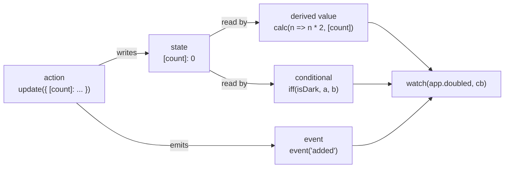
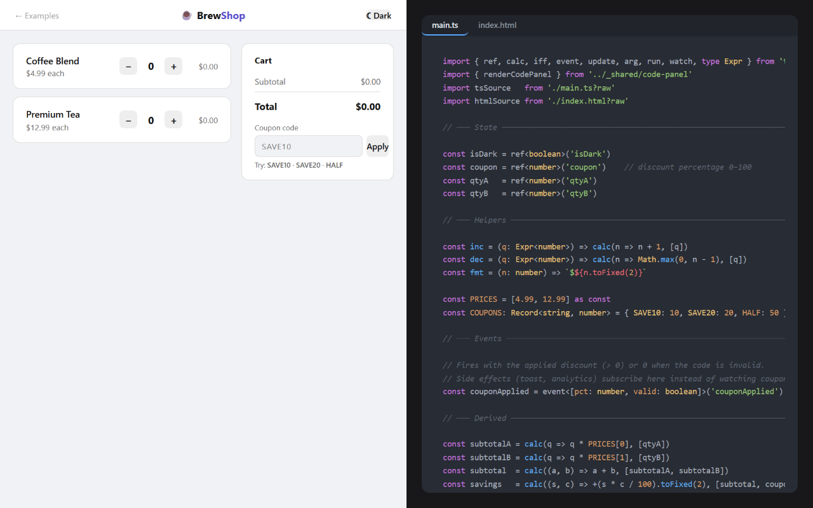

Describe app state as one plain object tree: state, derived values and actions. Then call `run()` to get a live, typed store.

[](https://www.npmjs.com/package/treem) · [Live examples](https://santistebanc.github.io/treem/) · [API reference](docs/api.md)



An action writes new values to state. Only the derived values that read that state compute again, and a watcher fires only when its value really changes. Events carry one-time signals, such as a toast, and do not keep a value.

## Install

```sh
npm install treem
```

## Examples

Each example is a file in [docs/examples/](docs/examples/). Run them all with `npm run examples`.

### Count clicks and derive a value

```ts
import { ref, calc, update, run, watch } from 'treem'

const count = ref<number>('count')

const app = run({
  [count]: 0,
  doubled: calc(n => n * 2, [count]),
  increment: update({ [count]: calc(n => n + 1, [count]) }),
})

watch(app.doubled, d => console.log('doubled is', d))

app.increment()
app.increment()
console.log('read:', app.doubled())
```

```text
doubled is 0
doubled is 2
doubled is 4
read: 4
```

### Switch a whole group of values with one condition

```ts
import { ref, calc, iff, update, run } from 'treem'

const theme = ref<'light' | 'dark'>('theme')
const isDark = calc(t => t === 'dark', [theme])

const app = run({
  [theme]: 'light',
  toggle: update({ [theme]: iff(isDark, 'light', 'dark') }),

  // Both branches are objects, so each key becomes its own reactive value
  colors: iff(isDark,
    { background: '#111', text: '#eee' },
    { background: '#fff', text: '#111' },
  ),
})

console.log(app.colors())
app.toggle()
console.log(app.colors.background())
```

```text
{ background: '#fff', text: '#111' }
#111
```

### Pass arguments and emit an event

```ts
import { ref, calc, event, update, arg, run, watch } from 'treem'

const items = ref<number>('items')
const added = event<[name: string, qty: number]>('added')

const cart = run({
  [items]: 0,
  label: calc(n => `${n} item(s)`, [items]),

  // One action changes state and emits an event
  add: update<string, number>({
    [items]: calc((n, qty) => n + qty, [items, arg<number>(1)]),
    [added]: [arg<string>(0), arg<number>(1)],
  }),
})

watch(added, (name, qty) => console.log(`toast: added ${qty} x ${name}`))

cart.add('coffee', 2)
cart.add('tea', 1)
console.log(cart.label())
```

```text
toast: added 2 x coffee
toast: added 1 x tea
3 item(s)
```

### Try it in the browser

The [live examples](https://santistebanc.github.io/treem/) include a counter, a traffic light, a signup wizard, a shop cart, an async search, a React todo app and a tree inspector. Their source is in [examples/](examples/).



## How it's built

- **One tree, one source of truth:** nested objects are scopes. A child scope reads state from its ancestors, and a nearer definition shadows a farther one.
- **Fine-grained updates:** each key is its own node. A change reruns only the nodes that depend on it, and stops when a result stays the same.
- **Safe actions:** an `update` reads all its values first and then writes them, so `update({ [a]: b, [b]: a })` swaps two values.
- **Typed and small:** TypeScript infers value and argument types from `ref<T>` and `update<Args>`. No runtime dependencies. 113 tests.

## More

- [API reference](docs/api.md): every primitive (`ref`, `calc`, `iff`, `update`, `arg`, `event`, `record`, `run`, `watch`), scope rules and a full wizard example.
- [Internals](INTERNALS.md): how the runtime builds and updates the tree.

## License

MIT.
